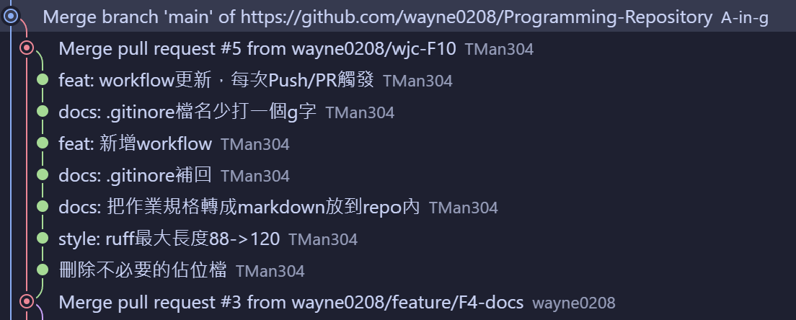
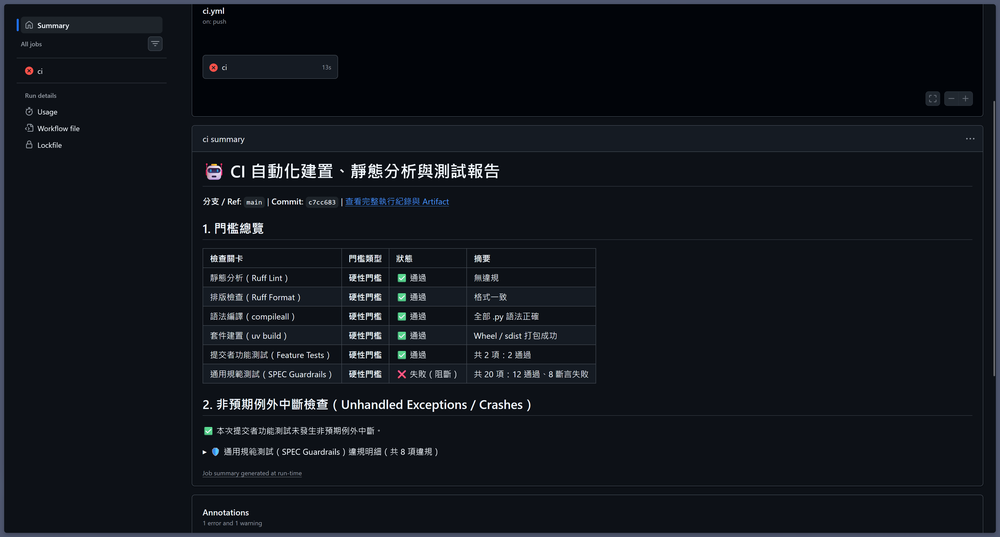
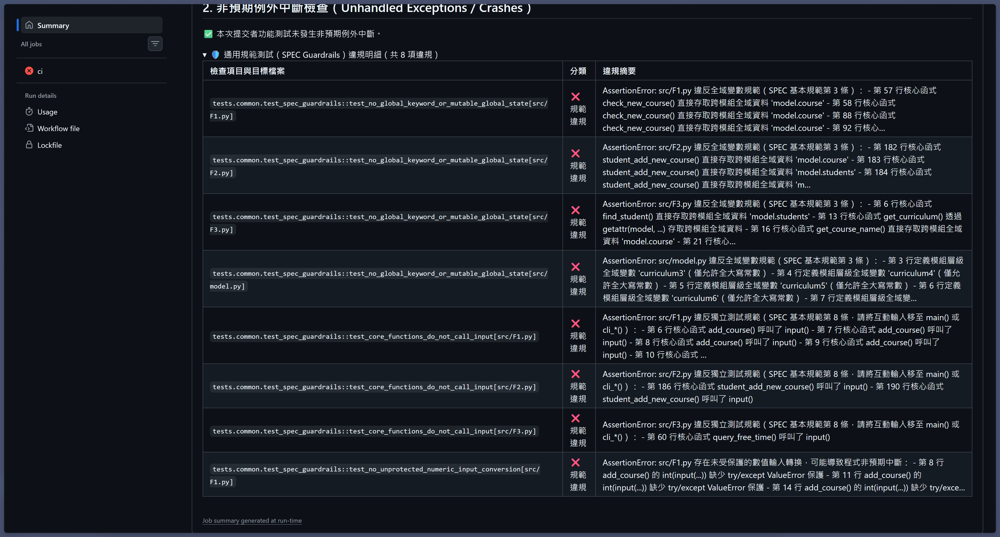

# 王界誠 ｜ 112AB0050 ｜ HW4

我的Git記錄：

## 一、負責模組說明

撰寫了自動化工作流，包含以下功能：

- 語法靜態分析
- 程式碼風格檢查
- 編譯打包
- 跑測試案例
- 產生報告

並寫了檢查全域變數、錯誤捕捉等的通用測試案例

## 二、測試結果

工作流跑過後的報告：

最後一項錯誤是因為之前的核心功能沒跑過通用測試

## 三、Review 其他成員程式紀錄

F1、F2、F3都違反了通用測試案例的規範：

未來與功能負責人討論並幫忙重構
